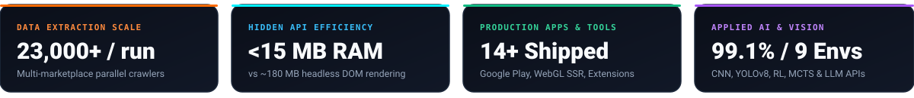

  

   

  

    
    
    
    
    
  

  

---

## ⚡ What I Build & Deliver

I'm **Trung Thanh Tran** (*Trần Trung Thành*), a Software Developer at **Madalena** and Computer Science student at **Industrial University of Ho Chi Minh City (IUH)** (`GMT+7`). I specialize in turning slow manual workflows and complex data sources into fast, automated, production-ready software.

| Domain | Core Capabilities & Deliverables |
| :--- | :--- |
| 🕷️ **Web Scraping & Hidden APIs** | High-concurrency async crawlers (`Python`, `httpx`, `asyncio`), headless browser pipelines (`Playwright`, `Puppeteer`, `Selenium`) for infinite-scroll / JS-heavy sites, XHR/Fetch private JSON API discovery, and idempotent exports to `CSV`, `JSON`, `Excel (.xlsx)`, `SQLite`, or `PostgreSQL`. |
| ⚙️ **Workflow & Browser Automation** | Custom **Manifest V3 Chrome Extensions** (`MAIN` + `ISOLATED` world bridges), multithreaded desktop automation suites (`Tkinter` + headless Chrome), **Google Sheets / Apps Script** real-time webhooks, and scheduled background sync engines. |
| 🌐 **Full-Stack Web & 3D UI** | Server-side rendered web apps (`React 19`, `TanStack Start`, `TypeScript`, `Tailwind CSS v4`), interactive 3D WebGL experiences (`Three.js`, `UnrealBloomPass`, custom Verlet physics), and cost-effective `Node.js` / `PHP` REST APIs. |
| 🤖 **Applied AI, Vision & Mobile** | LLM workflow integration (`OpenAI`, `Claude`, `Gemini APIs`), computer vision (`YOLOv8` + `ByteTrack`, `MediaPipe Pose`, `TensorFlow.js`), cross-platform mobile apps (`React Native / Expo` on Google Play, native `Kotlin`), and `ESP32` BLE firmware. |

---

## 🚀 Featured Flagship Projects (Public & Live)

<table>
  <tr>
    <td width="50%" valign="top">
      <h3 align="center">🕷️ Python Web Scraping & Hidden API Toolkit</h3>
      

        
      

      

        Production-grade Python extraction toolkit demonstrating three core scraping patterns on public sandbox targets:
      

      <ul>
        <li><b>Polite Async HTML Crawler (<code>scrape-books</code>):</b> Crawls 1,000+ paginated book pages with <code>httpx.AsyncClient</code>, <code>asyncio.Semaphore</code>, exponential backoff &amp; idempotent SQLite upserts.</li>
        <li><b>Infinite Scroll vs. Hidden JSON API (<code>compare-scroll</code>):</b> Cuts memory footprint from <b>~180 MB to &lt;15 MB</b> by bypassing DOM rendering.</li>
        <li><b>Reusable API Sniffer CLI (<code>sniff-api</code>):</b> Intercepts XHR/Fetch JSON endpoints on any JS page.</li>
      </ul>
      

        
        
        
      

    </td>
    <td width="50%" valign="top">
      <h3 align="center">🌐 Interactive 3D WebGL Portfolio & CMS</h3>
      

        
      

      

        Full-stack bilingual (<code>EN</code> / <code>VI</code>) portfolio engineered with <b>TanStack Start (SSR)</b>, <b>React 19</b>, <b>TypeScript</b>, and <b>Three.js</b>:
      

      <ul>
        <li><b>3D &amp; Physics Engines:</b> Isometric neon grid with <code>UnrealBloomPass</code> raycasting, 25-node Verlet rope physics badge, and a 3D CSS mechanical keyboard synced with an exploding SVG Donut Chart.</li>
        <li><b>Live GitHub API Sync:</b> Merges commercial case studies with live public repositories in an infinite film-strip carousel.</li>
        <li><b>Print-Engineered A4 CV &amp; CMS:</b> Dedicated <code>/cv</code> PDF route and Web Crypto SHA-256 <code>/admin</code> CMS.</li>
      </ul>
      

        
        
        
      

    </td>
  </tr>
  <tr>
    <td width="50%" valign="top">
      <h3 align="center">🎮 AI Game Arena — RL, MCTS & 3D Lab</h3>
      

        
      

      

        Cross-platform AI simulation lab (<b>Web SPA + Electron Desktop + Android Vision Agent</b>) featuring 9 environments written from scratch in pure TypeScript:
      

      <ul>
        <li><b>Game-Tree Search:</b> 20×20 Gomoku &amp; Connect Four using Web Worker Minimax (Alpha-Beta pruning, Iterative Deepening, Zobrist hashing) vs. MCTS (UCT), plus 2048 Expectimax.</li>
        <li><b>Neuroevolution &amp; RL:</b> Raycast 2D Autonomous Racing, Flappy Bird genetic evolution, Q-Learning Maze, and Three.js 3D Soccer &amp; Tag.</li>
        <li><b>Android Vision Agent:</b> Kotlin <code>MediaProjection</code> + <code>AccessibilityService</code> controller for live mobile games.</li>
      </ul>
      

        
        
        
      

    </td>
    <td width="50%" valign="top">
      <h3 align="center">📱 Serverless QR Check-In PWA + Sheets API</h3>
      

        
      

      

        Zero-server-cost mobile Progressive Web App (PWA) that scans member QR codes and logs attendance straight into <b>Google Sheets</b> in real time:
      

      <ul>
        <li><b>Continuous Queue Mode:</b> Non-blocking camera stream with a 3,000ms per-ID debounce map, scanning <b>~25 people/minute</b> while webhook requests process in the background.</li>
        <li><b>Google Apps Script Webhook (<code>doGet</code>):</b> Automatically locates or creates the <code>dd-MM-yyyy</code> date column, marks <code>"x"</code> on the member row, and returns JSON.</li>
        <li><b>Field-Tested UX:</b> 0.6x ultra-wide lens switcher, Web Audio API tones &amp; Web Speech API voice greeting.</li>
      </ul>
      

        
        
        
      

    </td>
  </tr>
</table>

---

## 🛠️ Selected Commercial & Private Engineering Highlights

Beyond my public repositories, here are production systems and automation tools I have built and shipped:

- 🛍️ **Madalena Customer Loyalty App & PHP Backend (Live on Google Play):** Sole developer of a production loyalty application (`React Native / Expo` + `PHP REST API` + `MySQL`, JWT auth, QR scanning, push notifications, cron jobs). Migrated backend infrastructure from Node.js on Render to shared PHP hosting to eliminate monthly cloud overhead.
- 📊 **Multi-Marketplace Used-Phone Price Scraper & Statistical Deal Hunter (`ToolPhone`):** Python + SQLite + Flask intelligence engine crawling **4 marketplaces in parallel across 113 phone models (23,000+ listings/run)** with 3-tier shop detection, 68 defect rules, Iglewicz-Hoaglin MAD outlier rejection, and lifecycle tracking (`first_seen` → `gone_at`) to eliminate survivorship bias (`+17%` price skew).
- 🤖 **E-Commerce Admin Automation & Order Exporter (`AutoTool`):** Multithreaded `Python` + `Tkinter` + headless `Selenium` + `OpenPyXL` desktop suite automating bulk inventory updates, flash-sale peak pricing with automatic rollback, and paginated order extraction into formatted Excel reports.
- 📝 **AI-Powered Notes, Schedule & AES-256 Vault Android App (`GhiChu`):** Ultra-lightweight (`<3 MB APK`) native Android app in pure `Kotlin` featuring **Google Gemini AI** natural-language schedule parsing, `AES-256-GCM` private vault, local-first `Supabase` sync, and 3 home-screen AppWidgets ([Source Repo](https://github.com/Tthanh2k6/GhiChu)).
- 🧭 **BLE Turn-by-Turn Navigation Engine & ESP32 Handlebar HUD (`MotoNav`):** Multi-module Android companion app (`Kotlin` + `Jetpack Compose`), shared bit-exact `C++17` binary protocol/vector core (`motonav_core`), and `ESP32` firmware streaming offline navigation over Bluetooth Low Energy.
- 🏋️ **FitCoach AI Web App (`fitness-app`):** Client-side **MediaPipe Pose** exercise form tracker and a custom-trained **MobileNetV3 (`PyTorch` → `TensorFlow.js`)** in-browser food photo classifier with zero GPU server cost.

---

## 🧰 Tech Stack & Tooling

  

    
  

  

    
  

---

## 📫 Let's Work Together

- 💼 **Upwork (Fastest response for project inquiries):** [upwork.com/freelancers/~01ee7c2348cb4b62fe](https://www.upwork.com/freelancers/~01ee7c2348cb4b62fe)
- 🌐 **Interactive 3D Portfolio & Printable CV:** [portfolio-red-theta-65.vercel.app](https://portfolio-red-theta-65.vercel.app/) · [View A4 CV](/cv)
- 📧 **Email:** [Ttrungthanh90@gmail.com](mailto:Ttrungthanh90@gmail.com)
- 🕒 **Timezone:** Ho Chi Minh City, Vietnam (`GMT+7` — overnight turnaround for US/EU clients)
