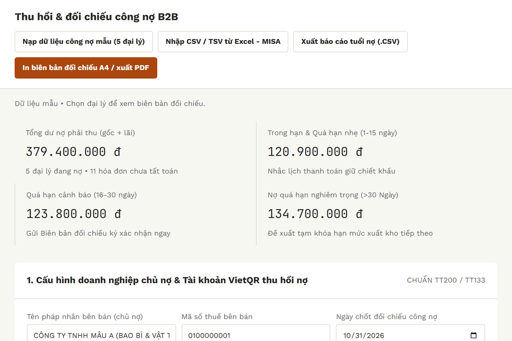

  

  

  

    
    
    
    
    
  

### 👋 Hi, I'm Thanh

Python & automation developer in Ho Chi Minh City (UTC+7). I build web scrapers, Apify Actors, n8n/Make workflows and small API services, and I prefer calling the JSON API behind a page over scraping the rendered HTML.

> **Need data from a website, or a manual workflow automated?** Send me the URL or the steps — I'll reply with a small sample before you commit. [Upwork](https://www.upwork.com/freelancers/trungthanhtrandev) · [Email](mailto:ttrungthanh90@gmail.com)

### 🛠️ What I work on

- 🕸️ **Web data** — async Python (`httpx`, Playwright) scrapers and Apify Actors → clean CSV / JSON / Google Sheets
- ⚙️ **Automation** — n8n & Make workflows, webhooks, CRM and Sheets integrations, Google Apps Script, Chrome extensions (MV3)
- 🤖 **AI features** — LLM extraction with strict JSON schemas, RAG search, small vision models
- 📱 **Apps** — React Native app + PHP REST API for a cosmetics retailer (current job since May 2026, built alone, live on Google Play)

### 🧰 Stack

  

  
  
  
  
  
  
  

### 🚀 Featured projects

<a href="https://tthanh2k6.github.io/vn-sme-offline-tools/"><b>vn-sme-offline-tools</b></a> — 9 offline browser tools for Vietnamese small businesses (VietQR cashier, debt aging, quotes, fleet fuel & toll reconciliation, e-invoice XML check). No server; data stays on the device.

  
  
  
  

<b>More public projects</b>

| Project | What it is |
| :--- | :--- |
| [apify-us-healthcare-clinic-contact-enricher](https://github.com/Tthanh2k6/apify-us-healthcare-clinic-contact-enricher) | Apify Actor: contact details from US clinic websites, with a simple chain-vs-independent keyword check |
| [twenty-crm-apify-b2b-sync](https://github.com/Tthanh2k6/twenty-crm-apify-b2b-sync) | Python sync from Apify results into Twenty CRM with dedupe and HMAC webhooks |
| [burgershop-pod-tool](https://github.com/Tthanh2k6/burgershop-pod-tool) | Manifest V3 Chrome extension that automates multi-step product listings |

### 📜 Certificates

     

