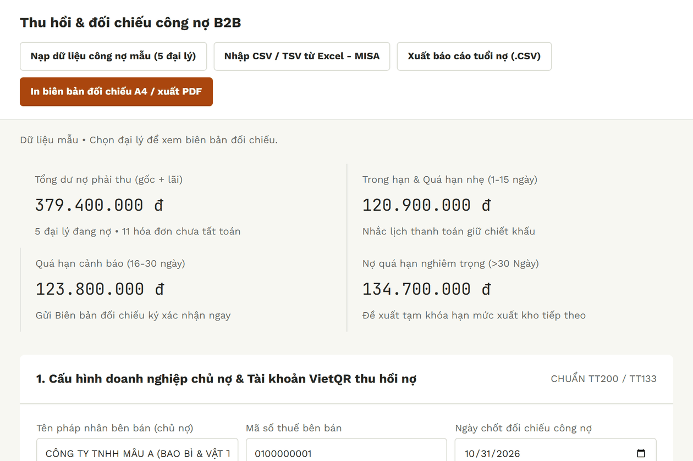

  

  

  

    
    
    
    
    
    
  

### Hi, I'm Thanh

Full-stack developer in Ho Chi Minh City (UTC+7). I build browser automation and MCP tools for AI agents, and I review Supabase/Postgres projects for the access-control mistakes that fast-built apps often have. Open to remote contract work, about 20–30 hours a week, async and in writing.

> Need browser automation for an agent or a scraper, or a Supabase RLS review? [Contra](https://contra.com/trung_thanh_tran_7tjnw73h) · [Upwork](https://www.upwork.com/freelancers/trungthanhtrandev) · [Email](mailto:ttrungthanh90@gmail.com)

### What I work on

- Browser automation for AI agents: [turbo-browser-mcp](https://github.com/Tthanh2k6/turbo-browser-mcp), an MCP server that fills whole forms, reads DOM deltas and runs action lists in one call (Show HN #7 front page, 133 stars, 781 tests), plus [cdp-share](https://github.com/Tthanh2k6/cdp-share) to share one Chrome remote-debugging approval across multiple agents. Also five public Apify Actors, n8n and Make workflows, Google Apps Script, webhooks.
- Supabase/Postgres security: Row Level Security and policy review, SECURITY DEFINER grants, Storage buckets. I wrote [supabase-rls-check](https://github.com/Tthanh2k6/supabase-rls-check), an open-source CLI, MCP server and GitHub Action (17 catalog rules, a scan for secret keys in public env variables and client/agent configs, and a diff between two runs; 133 tests, CI on PostgreSQL 15).
- React Native apps: full-time developer at Madalena, a cosmetics retailer, since March 2026. I built its loyalty app as the only developer (React Native, Expo, TypeScript, PHP REST API, Electron admin). It is on the App Store and Google Play.

### Stack

  

  
  
  
  
  
  
  
  

### Featured projects

**[turbo-browser-mcp](https://github.com/Tthanh2k6/turbo-browser-mcp)**: MCP server that lets AI agents drive a browser in fewer calls (v0.7.2, 11 tools, 781 tests). One call fills a whole form (React inputs, comboboxes, uploads from disk), snapshots return only what changed, `$secret:NAME` placeholders redact credentials from tool output, and final Submit/Pay clicks are blocked unless the agent is allowed to commit. `npx -y turbo-browser-mcp`
[npm](https://www.npmjs.com/package/turbo-browser-mcp) · [Wiki](https://github.com/Tthanh2k6/turbo-browser-mcp/wiki) · [Release notes](https://github.com/Tthanh2k6/turbo-browser-mcp/releases) · [Article](https://dev.to/tthanh2k6/building-a-faster-playwright-mcp-server-compact-dom-deltas-1-turn-form-filling-and-submit-guards-2o2p)

**[supabase-rls-check](https://github.com/Tthanh2k6/supabase-rls-check)**: read-only checks for Supabase RLS, policies, SECURITY DEFINER grants and public buckets. CLI, MCP server and GitHub Action; 17 catalog rules, 133 tests. `pipx install supabase-rls-check`
[PyPI](https://pypi.org/project/supabase-rls-check/) · [Glama](https://glama.ai/mcp/servers/Tthanh2k6/supabase-rls-check) · [Agent skill on Agensi](https://www.agensi.io/skills/supabase-rls-review) · [Cursor plugin](https://github.com/Tthanh2k6/supabase-rls-plugin)

**Race-safe salon booking** (Cloudflare Workers + D1): five simultaneous requests for the same technician and time give 1 booking and 4 rejections. Per-technician iCal feeds, admin page, English/Vietnamese UI, 11 tests.
[Live demo](https://lotus-nail-booking.lotus-nail-booking-v2.workers.dev) (deposits are turned off on the demo)

**[supabase-multitenant-rls](https://github.com/Tthanh2k6/supabase-multitenant-rls)**: reference migration for many customers in one shared Postgres schema on Supabase. Forced RLS, roles from a memberships table, composite keys that block cross-tenant references, tenant-scoped Storage. 19 tests sign in as real users and try to cross the boundary; CI also lints the schema with supabase-rls-check (0 findings).

**[market-data-pipeline](https://github.com/Tthanh2k6/market-data-pipeline)**: Python job that pulls free market data (indices, FX, crypto, commodities, bonds, VIX), normalizes OHLCV to UTC, validates it, adds indicators and upserts into Supabase. A dry run fetches all 14 symbols without a database; the scheduled workflow is off for now. 23 tests.

**[remote-contract-jobs](https://github.com/Tthanh2k6/remote-contract-jobs)**: CLI and MCP server that collects remote contract and part-time developer jobs from 9 public sources (8 in the current PyPI release) and filters out location, video-call and ID-document blockers. 95 tests. [PyPI](https://pypi.org/project/remote-contract-jobs/)

**n8n templates**: [n8n-retry-after](https://github.com/Tthanh2k6/n8n-retry-after) reads `Retry-After` (seconds or HTTP date), falls back to jittered backoff and defers long waits instead of holding the workflow open (13 tests). [n8n-lead-followup-drafts](https://github.com/Tthanh2k6/n8n-lead-followup-drafts) turns a Google Sheet of leads into AI-written Gmail drafts that a person reviews and sends; re-runs do not create duplicate drafts (27 tests). Neither has been run against live accounts yet.

<a href="https://github.com/Tthanh2k6/discord-membership-bot"><b>discord-membership-bot</b></a>: Discord bot that gives a paid role to members with an active Stripe, Whop or Zapier/Make subscription and removes it when the paid period ends; posts Shopify order alerts without customer contact details. Node.js, discord.js, node:sqlite, 57 offline tests.

<a href="https://tthanh2k6.github.io/vn-sme-offline-tools/"><b>vn-sme-offline-tools</b></a>: 9 offline browser tools for Vietnamese small businesses (VietQR cashier, debt aging, quotes, fleet fuel & toll reconciliation, e-invoice XML check). No server; data stays on the device.

  
  
  
  

The Apify Actors were published in October 2026 and are still new.

<b>More public projects</b>

| Project | What it is |
| :--- | :--- |
| [apify-us-healthcare-clinic-contact-enricher](https://github.com/Tthanh2k6/apify-us-healthcare-clinic-contact-enricher) | Apify Actor: contact details from US clinic websites, with a simple chain-vs-independent keyword check |
| [expo-upgrade-casebook](https://github.com/Tthanh2k6/expo-upgrade-casebook) | Open-source Expo SDK 49 to 58 upgrade case study with commit-by-commit fixes (60 Jest suites, 187 tests, Android export CI) |
| [expo-build-doctor](https://github.com/Tthanh2k6/expo-build-doctor) | Zero-dependency Node CLI checking Expo `app.json`, `eas.json`, and `package.json` for build and store blockers (21 rules, 26 tests) |
| [rn-upgrade-check](https://github.com/Tthanh2k6/rn-upgrade-check) | Zero-dependency Node CLI checking React Native and Expo dependencies against React Native Directory (22 tests) |
| [chatbot-eval-harness](https://github.com/Tthanh2k6/chatbot-eval-harness) | End-to-end RAG chatbot QA harness using node:test, promptfoo, and Playwright (15 unit tests, 40-prompt suite) |
| [twenty-crm-apify-b2b-sync](https://github.com/Tthanh2k6/twenty-crm-apify-b2b-sync) | Python sync from Apify results into Twenty CRM with dedupe and HMAC webhooks |
| [moto-nav](https://github.com/Tthanh2k6/moto-nav) | Android app + ESP32 handlebar display for turn-by-turn directions over BLE (learning project) |

### Latest articles

<!-- BLOG-POST-LIST:START -->
- [Four DOM Traps That Make Browser Agents Click or Fill the Wrong Element](https://dev.to/tthanh2k6/four-dom-traps-that-make-browser-agents-click-or-fill-the-wrong-element-7ie)
- [One &quot;Allow remote debugging&quot; click for every agent on my Chrome](https://dev.to/tthanh2k6/one-allow-remote-debugging-click-for-every-agent-on-my-chrome-38l5)
- [What broke when an AI agent drove real websites overnight through my MCP browser server](https://dev.to/tthanh2k6/what-broke-when-an-ai-agent-drove-real-websites-overnight-through-my-mcp-browser-server-4nje)
- [Building a Faster Playwright MCP Server: Compact DOM Deltas, 1-Turn Form Filling, and Submit Guards](https://dev.to/tthanh2k6/building-a-faster-playwright-mcp-server-compact-dom-deltas-1-turn-form-filling-and-submit-guards-2o2p)
<!-- BLOG-POST-LIST:END -->

### Open-source contributions

Merged pull requests in upstream repositories:

- **[ChromeDevTools/chrome-devtools-mcp#3539](https://github.com/ChromeDevTools/chrome-devtools-mcp/pull/3539)** `--backgroundNewPages`: opens new MCP-created tabs in the background so automated runs do not steal focus (merged 19 Nov 2026).
- **[callstack/react-native-testing-library#1964](https://github.com/callstack/react-native-testing-library/pull/1964)** `fix: remove global jest namespace dependency from matcher types`: lets TypeScript projects use matcher types without ambient `@types/jest` globals (merged 22 Nov 2026).
- **[tabloy/keygate#147](https://github.com/tabloy/keygate/pull/147)** `fix(store): escape LIKE metacharacters in admin list searches`: treats `%`, `_` and `\` as literal characters across six admin searches (merged 15 Nov 2026).
- **[tabloy/keygate#144](https://github.com/tabloy/keygate/pull/144)** `fix(web): restore default border color for Tailwind v4`: restores the default border colour after the Tailwind v4 upgrade (merged 13 Nov 2026).

### Certificates

     

