  

  

  

    
    
    
    
    
    
  

### Hi, I'm Thanh

Full-stack developer in Ho Chi Minh City (UTC+7). I build low-token browser/desktop automation and MCP servers for AI coding agents, and I audit Supabase/Postgres projects for Row Level Security mistakes. Open to remote contract or part-time work (20-30 hours/week, async, English B2).

> Need browser/MCP automation or a Supabase RLS audit? [Contra](https://contra.com/trung_thanh_tran_7tjnw73h) · [Upwork](https://www.upwork.com/freelancers/trungthanhtrandev) · [Email](mailto:ttrungthanh90@gmail.com)

### What I work on

- **AI agent browser & MCP tooling:** [turbo-browser-mcp](https://github.com/Tthanh2k6/turbo-browser-mcp) (v0.7.3, 152+ stars, #7 Hacker News front page, 790 tests, npm) and [cdp-share](https://github.com/Tthanh2k6/cdp-share) to share one approved Chrome remote-debugging session across multiple agents.
- **Supabase / Postgres security:** [supabase-rls-check](https://github.com/Tthanh2k6/supabase-rls-check), a read-only CLI, MCP server and GitHub Action (17 catalog rules, leaked `service_role` key scanner, 133 tests on PostgreSQL 15, PyPI + Glama Grade A).
- **Production mobile & full-stack:** Full-time developer at Madalena since March 2026, where I built and shipped the customer loyalty app (React Native, Expo, TypeScript), PHP REST API, and Electron admin solo (App Store and Google Play).

### Stack

  

  
  
  
  
  
  
  

### Featured projects

**[turbo-browser-mcp](https://github.com/Tthanh2k6/turbo-browser-mcp)** (`v0.7.3`, **152+ stars**, **790 tests**): Low-token Playwright MCP server with 11 batched tools, compact DOM deltas, 1-turn form filling (including disk file uploads), `$secret:NAME` output redaction, and default Submit/Pay guards. Cut 3-task Claude E2E runs from 42 turns ($0.395) to 17 turns ($0.21) on Sonnet and 18 turns ($0.015) on Haiku. `npx -y turbo-browser-mcp`
[npm](https://www.npmjs.com/package/turbo-browser-mcp) · [Wiki](https://github.com/Tthanh2k6/turbo-browser-mcp/wiki) · [Release notes](https://github.com/Tthanh2k6/turbo-browser-mcp/releases) · [E2E Benchmark](https://dev.to/tthanh2k6/i-benchmarked-four-browser-mcp-stacks-with-claude-code-and-mine-lost-on-cost-first-2d8g)

**[cdp-share](https://github.com/Tthanh2k6/cdp-share)**: Zero-dependency Node.js daemon that holds one approved Chrome 144+ remote-debugging connection and multiplexes isolated CDP sessions for Playwright, Puppeteer, `chrome-devtools-mcp`, and `turbo-browser-mcp`, with token auth and JSONL command logging.

**[supabase-rls-check](https://github.com/Tthanh2k6/supabase-rls-check)** (**133 tests**, PyPI, Glama Grade A): Read-only PostgreSQL catalog auditor, MCP server and GitHub Action flagging 17 RLS, `SECURITY DEFINER`, grant and public-bucket issues plus leaked `service_role` keys. `pipx install supabase-rls-check`
[PyPI](https://pypi.org/project/supabase-rls-check/) · [Glama](https://glama.ai/mcp/servers/Tthanh2k6/supabase-rls-check) · [Agensi Skill](https://www.agensi.io/skills/supabase-rls-review) · [Cursor plugin](https://github.com/Tthanh2k6/supabase-rls-plugin)

**[supabase-multitenant-rls](https://github.com/Tthanh2k6/supabase-multitenant-rls)**: Shared-schema multi-tenant RLS reference on Supabase (forced RLS, membership roles, composite `(id, tenant_id)` keys, tenant-scoped Storage, 19 live cross-tenant tests).

**Race-safe salon booking** (Cloudflare Workers + D1 + Stripe): Five simultaneous requests for the same technician and slot yield 1 booking and 4 rejections, with Stripe Checkout deposits verified in Web Crypto and per-technician iCal feeds (11 tests). [Live demo](https://lotus-nail-booking.lotus-nail-booking-v2.workers.dev)

<b>More public projects (15+ repos: Expo/RN tools, Apify Actors, n8n, SME tools)</b>

| Project | What it is |
| :--- | :--- |
| [remote-contract-jobs](https://github.com/Tthanh2k6/remote-contract-jobs) | Python CLI + MCP server collecting remote contract/part-time dev jobs from 9 public feeds (95 tests, [PyPI](https://pypi.org/project/remote-contract-jobs/)) |
| [expo-upgrade-casebook](https://github.com/Tthanh2k6/expo-upgrade-casebook) | Open-source Expo SDK 49 to 58 New Architecture upgrade case study (60 Jest suites, 187 tests, Android export CI) |
| [expo-build-doctor](https://github.com/Tthanh2k6/expo-build-doctor) | Zero-dependency Node CLI checking Expo `app.json`, `eas.json`, and `package.json` for build and store blockers (21 rules, 26 tests) |
| [rn-upgrade-check](https://github.com/Tthanh2k6/rn-upgrade-check) | Zero-dependency Node CLI checking React Native and Expo dependencies against React Native Directory (22 tests) |
| [chatbot-eval-harness](https://github.com/Tthanh2k6/chatbot-eval-harness) | End-to-end RAG chatbot QA harness using `node:test`, promptfoo (40 cases), and Playwright |
| [vn-sme-offline-tools](https://github.com/Tthanh2k6/vn-sme-offline-tools) | 9 offline browser tools for Vietnamese small businesses ([Live demo](https://tthanh2k6.github.io/vn-sme-offline-tools/)) |
| [discord-membership-bot](https://github.com/Tthanh2k6/discord-membership-bot) | Discord paid-role sync for Stripe/Whop/Zapier/Make webhooks + Shopify order alerts (57 offline tests) |
| [market-data-pipeline](https://github.com/Tthanh2k6/market-data-pipeline) | Python pipeline pulling daily market data into Supabase via GitHub Actions (23 tests) |
| [n8n-retry-after](https://github.com/Tthanh2k6/n8n-retry-after) & [n8n-lead-followup-drafts](https://github.com/Tthanh2k6/n8n-lead-followup-drafts) | n8n templates for `Retry-After` jittered backoff (13 tests) and idempotent Gmail follow-up drafts (27 tests) |
| [Apify Store (5 Actors)](https://apify.com/thanh81646) | Async Python scrapers: B2B contact enricher, Shopify/WooCommerce price monitor, US clinic finder, Malaysia property scraper, route optimizer |
| [web-scraping-showcase](https://github.com/Tthanh2k6/web-scraping-showcase) | 3 Python scrapers showing JSON-API-first extraction on `toscrape.com` |
| [moto-nav](https://github.com/Tthanh2k6/moto-nav) | Android app + ESP32 handlebar display for turn-by-turn directions over BLE |

### Open-source contributions

Merged pull requests in upstream repositories:

- **[supabase/supabase#53624](https://github.com/supabase/supabase/pull/53624)** `docs(realtime): use public.rooms_users consistently in authorization` (80k+ stars, merged 24 Nov 2026).
- **[ChromeDevTools/chrome-devtools-mcp#3539](https://github.com/ChromeDevTools/chrome-devtools-mcp/pull/3539)** `--backgroundNewPages`: opens new MCP-created tabs in the background so automated runs do not steal focus (58k+ stars, merged 19 Nov 2026).
- **[callstack/react-native-testing-library#1964](https://github.com/callstack/react-native-testing-library/pull/1964)** `fix: remove global jest namespace dependency from matcher types`: lets TypeScript projects use matcher types without ambient `@types/jest` globals (merged 22 Nov 2026).
- **[tabloy/keygate#147](https://github.com/tabloy/keygate/pull/147)** `fix(store): escape LIKE metacharacters in admin list searches` (merged 15 Nov 2026).
- **[tabloy/keygate#144](https://github.com/tabloy/keygate/pull/144)** `fix(web): restore default border color for Tailwind v4` (merged 13 Nov 2026).

### Latest articles

<!-- BLOG-POST-LIST:START -->
- [Driving Android Phones Over ADB Without Screenshot Loops or Raw XML Dumps &lpar;turbo-android-mcp&rpar;](https://dev.to/tthanh2k6/driving-android-phones-over-adb-without-screenshot-loops-or-raw-xml-dumps-turbo-android-mcp-3ap5)
- [My AI coding agent was loading 1,587 skills and 69 browser tools on every prompt](https://dev.to/tthanh2k6/my-ai-coding-agent-was-loading-1587-skills-and-69-browser-tools-on-every-prompt-116i)
- [Driving Windows Apps Without Sending 10 Screenshots per Task &lpar;turbo-desktop-mcp&rpar;](https://dev.to/tthanh2k6/driving-windows-apps-without-sending-10-screenshots-per-task-turbo-desktop-mcp-2bmk)
- [Stopping AI Browser Agents from Stealing Chrome Window Focus over CDP](https://dev.to/tthanh2k6/stopping-ai-browser-agents-from-stealing-chrome-window-focus-over-cdp-1bo7)
<!-- BLOG-POST-LIST:END -->

### Certificates

     

